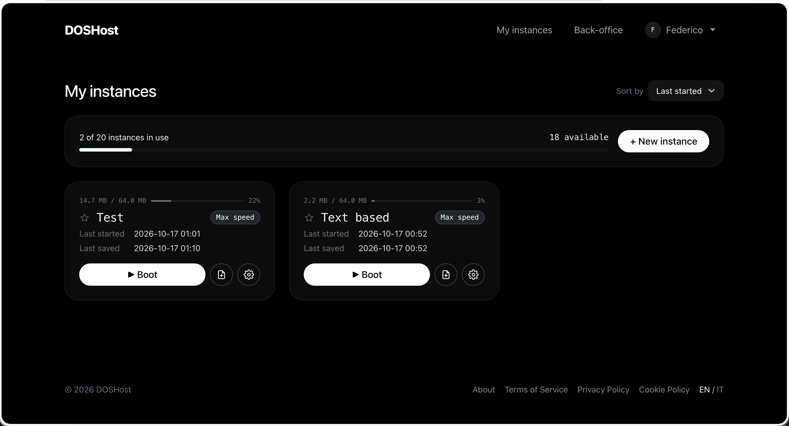

# DOSHost

Self-hosted DOS machines in the browser: PHP 8 + MySQL, Bootstrap, `fetch`,
DOSBox through [js-dos](https://js-dos.com) (WebAssembly, served locally). No Composer/npm dependencies at runtime.



## Quick start

```bash
cp .env.example .env        # then edit DB_* and ADMIN_*
php bin/migrate.php         # optional: the site creates the tables and the admin on its first visit
./serve.sh                  # http://localhost:8000
```

`php bin/migrate.php --fresh` drops every table and runs the migrations again.
If MySQL does not answer, both the script and the site show a clear message (`DatabaseException`).

## Structure

```
app/Core/         mini framework: Env, Database, Router, Request, Response, View,
                  Session, Auth, Csrf, Middleware, Translator, Migrator
app/Models/       User, Instance, Setting (minimal active record)
app/Services/     DiskService (.jsdos disks), AvatarService (profile pictures)
app/Controllers/  Home, Page, Auth, Dashboard, Instance, Account, Admin
routes/web.php    every route with its middleware (auth, guest, admin)
views/            layouts/, components/, pages/   (plain PHP, Blade-like)
lang/             messages.pot + {en,it}/LC_MESSAGES/messages.po
database/migrations/
public/           index.php, assets/, vendor/ (bootstrap, js-dos)
storage/          disks/{uuid}/bundle.jsdos, avatars/, logs/
```

A page: `return view('pages/dashboard', [...])`. A component: `<?= component('instance-card', [...]) ?>`.
Forms with `data-ajax` are sent with `fetch` and receive `{ok, message, errors, redirect}`;
buttons with `data-confirm` + `data-action` go through the confirmation modal.

## How the disk works

Each instance is a js-dos bundle (`storage/disks/{uuid}/bundle.jsdos`): a zip with `.jsdos/dosbox.conf`
plus the whole content of `C:`. Zip files uploaded at creation, or later with the file icon, are extracted
into `C:` without ever overwriting files that are already there.
The browser sends the whole disk every `AUTOSAVE_MINUTES`, on «Save», when the tab gets hidden,
on «Save & exit» and when DOS `EXIT` is typed (a hash avoids useless uploads). The previous file is kept
as `bundle.jsdos.bak`. If `C:\AUTOEXEC.BAT` exists, the instance runs it at every start.

The size of an instance is the size of its compressed disk: above `DISK_WARN_PERCENT` a warning appears,
above `DISK_MAX_MB` saving is refused until some data is deleted.
The emulator's RAM is not saved: the disk is kept, not the state of the running program.

## Translations

Strings are in English in the code: `__('Hello, :name', ['name' => $n])`.

```bash
php bin/i18n.php   # regenerates lang/messages.pot and adds the new strings to the .po files
```

The `.po` files can be edited with any editor or with Poedit; there is no need to compile them to `.mo`.

## Shared hosting (Apache + PHP + MySQL)

Requirements: **PHP 8.1+** with the `pdo_mysql`, `zip`, `gd`, `mbstring` extensions; MySQL 5.7+ / MariaDB 10.3+;
Apache with `mod_rewrite`. It works in the root of a domain (`https://dos.example.com`) or in a
subfolder (`https://example.com/doshost`): the path is taken from `APP_URL`.

1. **Upload the files** (FTP or file manager), keeping the project structure.
2. **Public folder** — from the safest option:
   - *project outside the web folder* (e.g. Tophost, cPanel): the project goes in your home, next to the
     web folder, and the web folder gets **only the content of `public/`**.
     `index.php` finds the project in `../doshost` by itself:
     ```
     home/
       doshost/     ← whole project (app, storage, .env…): no URL
       htdocs/      ← content of doshost/public (index.php, assets, vendor, .htaccess, .user.ini)
     ```
   - *document root set to `public/`*, if your control panel allows it;
   - *last resort*: the whole project inside the web folder; the `.htaccess` in the project root sends
     every request to `public/`, and the private folders have their own deny-all `.htaccess`.

   Data (disks, avatars, logs) lives in the project's `storage/`; with `STORAGE_PATH` in `.env`
   you can move it elsewhere, with an absolute path or one relative to the project (e.g. `../doshost-data`).
   It must never be inside the web folder.
3. **Database** — create the database and its user from the control panel and write them in `.env`. Nothing else:
   on the **first visit** the site creates the tables (from `database/migrations/*.sql`) and the admin
   set in `ADMIN_EMAIL` / `ADMIN_PASSWORD`. With SSH you can also run `php bin/migrate.php`;
   otherwise the `.sql` file can be imported as it is with phpMyAdmin.
4. **`.env`** — copy `.env.example` to `.env` and set at least: `APP_URL` (with https), `APP_DEBUG=false`,
   `DB_*`, `ADMIN_*`, `LEGAL_*`.
5. **Permissions** — `storage/disks`, `storage/avatars` and `storage/logs` must be writable by PHP (usually 755 or 775).
6. **Upload limits** — `public/.user.ini` raises `post_max_size` / `upload_max_filesize` to 80M (works with PHP-FPM/CGI);
   if your host uses something else, set values higher than `DISK_MAX_MB` from its PHP settings.
7. **HTTPS** on (Let's Encrypt from the control panel): the session cookie and the policies rely on it.

Check: open `https://yourdomain/` (home), `https://yourdomain/.env` and `https://yourdomain/storage/logs/app.log`
(they must answer 404/403) and `https://yourdomain/vendor/js-dos/emulators/wdosbox.wasm` (it must download as `application/wasm`).

If something goes wrong:
- **error 500 right away**: some hosts don't allow `Options` in `.htaccess` → remove the `Options -Indexes` lines;
  if it is still 500, uncomment `RewriteBase` in the two `.htaccess` files (project root and `public/`);
- **404 pages while the home page works**: check that `APP_URL` matches the address exactly (subfolder included);
- **blank page or PHP error**: with `APP_DEBUG=true` the error is shown; PHP 8.1 or later is required;
- **missing `.htaccess` files**: many FTP clients hide files starting with a dot: check them from the file manager.

To update: upload the new files without touching `.env` and `storage/`. Database changes go in
new `database/migrations/YYYY_MM_DD_NNNNNN_description.sql` files: the site applies them by itself, once
each, on the first request that finds a missing table or column (or run `php bin/migrate.php`).

## Production

- Point the document root to `public/` (there is an `.htaccess` for Apache; with nginx use `try_files $uri /index.php`).
  Without access to the document root, see «Shared hosting» above.
- Serve `.wasm` files as `application/wasm`.
- Raise `post_max_size` / `upload_max_filesize` above `DISK_MAX_MB` (see `public/.user.ini`).
- `APP_DEBUG=false`, HTTPS, and make `storage/` writable.

## Bundled libraries

Served locally from `public/vendor/`, no CDN:

- [js-dos](https://js-dos.com) 8.4.1 (DOSBox / DOSBox-X compiled to WebAssembly) — GPL-2.0
- [Bootstrap](https://getbootstrap.com) 5.3.3 — MIT

## License

[MIT](LICENSE). The bundled libraries keep their own licenses (see above).
